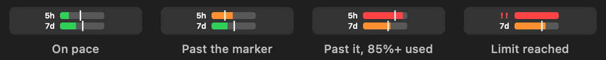
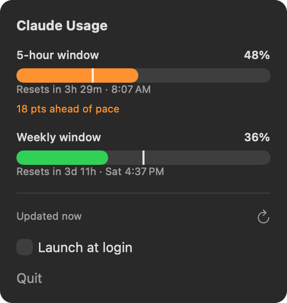
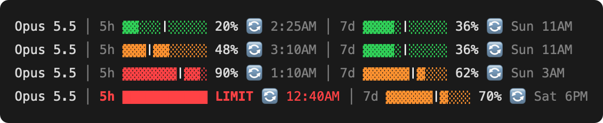

# Claude Usage Meter

A minimal take on [Claude-Usage-Tracker](https://github.com/hamed-elfayome/Claude-Usage-Tracker):
your Claude plan usage in the macOS menu bar and the Claude Code status line.

Each window (5-hour and weekly) is a bar filled to your utilization, with a vertical
marker showing how much of the window has elapsed — fill past the marker means
you're burning faster than even pace.

The marker is only a pace guide — you can keep using Claude past it; the real limit is
the end of the bar. So bars are **green** at or behind the marker, **orange** once past
it (on track to run out before reset), and **red** when past it *and* at 85%+ of the bar.
Pace is ignored below 10% used, so a brand-new window doesn't start out orange. At 100%
the window shows as blocked (`!!` in the menu bar, `LIMIT` in the status line) with the
time it comes back.

## Screenshots

**Menu bar**: the 5-hour window on top, weekly below. The white tick is the elapsed-time marker.



**Popover**: click the bars for exact numbers, reset times, and how far ahead of pace you are.



**Claude Code status line**



## Install

### Homebrew

```sh
brew install --cask ha404/tap/claude-usage-meter
open -a ClaudeUsageMeter
```

The app is ad-hoc signed, not notarized, so macOS blocks the first launch. Allow it once
in **System Settings → Privacy & Security → Open Anyway**, then open it again.

To show usage in Claude Code too, click the bars and choose **Set up Claude Code status
line** (it needs `jq`, which macOS 15+ includes; otherwise `brew install jq`).

### Release zip

Download `ClaudeUsageMeter.zip` from the
[latest release](https://github.com/ha404/claude-usage-meter/releases/latest), unzip it
into `~/Applications`, and open it. The same **Open Anyway** step applies.

### From source

```sh
./scripts/build-app.sh          # builds, installs to ~/Applications, launches (registers at login)
./scripts/install-statusline.sh # installs ~/.claude/usage-meter-statusline.sh into settings.json
```

Only the Command Line Tools are needed (no Xcode). To regenerate the screenshots
from sample data, run `./scripts/screenshots.sh`; to run the tests, `swift test`.

## Updates

Every push to `main` is built and published as a release (`v1.0.<commit count>`) by
[`.github/workflows/release.yml`](.github/workflows/release.yml).

With **Update automatically** ticked in the popover (the default), the app checks for a
newer release at launch and every 6 hours, downloads it, verifies its SHA-256 against
the one GitHub reports along with its bundle ID, version and code signature, swaps
itself out and relaunches. Untick it to update by hand with **Check now** → **Install**.

The app updates itself, so Homebrew leaves it alone (`auto_updates true` in the cask).
An app update also refreshes the installed status line script.

## How it works

- The app reads Claude Code's OAuth token from the Keychain (`Claude Code-credentials`)
  via `/usr/bin/security` and polls `https://api.anthropic.com/api/oauth/usage` every 60s.
  It never refreshes the token (that would sign Claude Code out); if it's expired,
  values go dim until Claude Code refreshes it.
  Failed requests back off (up to 15 minutes, or whatever `Retry-After` says).
- After each fetch it writes `~/.claude/usage-meter-cache.json`.
- The status line uses the `rate_limits` Claude Code passes on stdin, falling back to
  that cache (if under 10 minutes old).

## License

[MIT](LICENSE)
